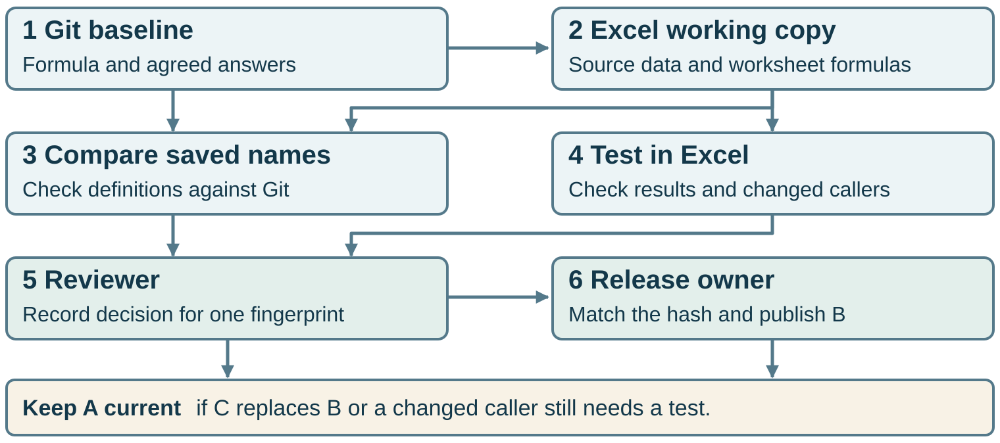

# From review to release

Readers open **Current.xlsx** in the released folder. The maintainer submits a separate working copy for review. Riley, the reviewer, records a decision against the exact bytes tested. **Morgan, the designated release owner, is the only person who replaces Current.xlsx.** The rule owner controls the expected answers in Git. Riley and Morgan are illustrative roles.

At the start of each scenario [A](../example.xlsx) is current. [B](../approval/B-data.xlsx) is the reviewed rename for ID-108. Each request records its workbook fingerprint, Git baseline and test evidence. When Riley accepts a request, Morgan reads the submission once, checks its SHA-256 against Riley’s decision and publishes those same bytes. Readers keep using the prior release until that replacement succeeds.



| What reaches Morgan | Review and release action | What readers get |
| --- | --- | --- |
| The reviewed B. Its eight cases and the two separate rename checks pass. | Riley accepts B. Morgan verifies the bytes at the submission link match B’s fingerprint and replaces Current.xlsx. | **B is current.** The prior A is available for rollback. |
| [C replaces B](C-replacement.xlsx) at the same submission link while Riley is reviewing B. C changes Label B to Label C. Its original eight cases also pass. | Riley’s response still names B. Morgan finds C’s fingerprint at publication time, records the response as stale for this submission and requests a fresh review of C. | **A stays current.** C has its own review even when its eight results match A’s. |
| [A mixed B](B-mixed.xlsx) combines B’s rename with a new formula on the Summary sheet. | Riley holds the whole file until the new caller has a test. That test fails, so Riley rejects this copy and returns it to the maintainer. | **A stays current** during the hold and after rejection. |

The [previous approval example](../approval/README.md) explains the decision for B. Its fingerprint starts with `b8dc0a845e7f`. C starts with `b86374023e9b`. A filename or link can stay the same while the workbook it serves changes. The [Excel evidence](evidence.json) records the full fingerprints and saved results for both new workbooks.

## Try the mixed edit in Excel

1. Open the mixed B and compare **Records!B13** with A. The label for ID-108 changed from Label A to Label B. The original eight cases still pass.
2. Inspect **Summary!C6**. It uses a first-match lookup for the label in B6. The original cases exercise the governed function on the Cases sheet. They never call this summary. Place the whole candidate on hold when any changed caller lacks coverage, including a caller whose purpose or owner is unclear.
3. Use the independently recorded Beta expectation from [version A, case row 7](https://github.com/wornpage/governed-excel-formula-module-kit/blob/535ba49f28f0c3087e0634e444d10d226782fb85/verification.json). Two records share the label, so the expected return is empty text. Recalculate. Summary!C6 returns **ID-102**. The original suite is **8/8** and the additional caller check is **0/1**. Return this workbook for correction. A corrected copy needs its own fingerprint, caller check and decision.

## Run the release example

From the extracted kit folder, run with Python 3.10 or later:

```text
python -B release/demo.py
```

The program creates a temporary inbox and a released folder. It reads the Excel results saved in the supplied fixtures, uses the original approved expectations and checks the actual bytes of Current.xlsx after each decision. It prints **RELEASED → B**, **STALE → A**, **HOLD → A**, then **REJECT → A**. Each scenario starts again at A.

For a team rollout, give the release owner write access to the released location and readers read access. Retain the prior version. Log the request, reviewer, decision time, reviewed fingerprint, fingerprint observed at publication and which release is current. The local example models the two roles in one process. A team could route the decision with Power Automate and enforce the permissions in its chosen storage service.
