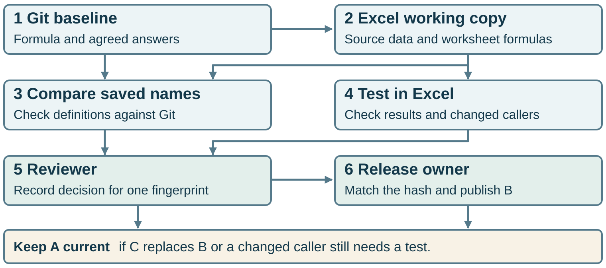

# Route one workbook version for approval

**Proposed Power Automate flow.** Riley reviews a particular version of a workbook in SharePoint. Power Automate Approvals stores the approval and response in Dataverse. A custom Dataverse table, **WorkbookReview**, associates the native approval ID with the tested file version and its SHA-256 fingerprint. Morgan, the release owner, uses that association to decide whether to replace **Current.xlsx**. The local kit models this handoff with fictional cloud records and the real sample workbooks.

## Follow request R-017

| Record | Worked value | What it establishes |
| --- | --- | --- |
| SharePoint submission | Drive `reviews-drive`, item `workbook-41`, version `2.0` | The exact version of B that Riley is asked to review. |
| Tested workbook | SHA-256 begins `b8dc0a845e7f`. The [pinned Excel evidence](https://github.com/wornpage/governed-excel-formula-module-kit/blob/8a69a6cbd4dee4ff57e375c9932252c66e79b05a/approval/decisions.json) identifies B-data. | The returned IDs match all eight agreed answers. The rename also passes its two focused checks. |
| Native approval and response | Approval ID `a1100000-0000-4000-8000-000000000017`. Riley responds **Approve**. | The native response identifies its parent approval. Verify Riley’s directory identity, outcome and response time on that approval. |
| Custom WorkbookReview row | `R-017` stores that approval ID, assigned reviewer, drive, item, version, **full** SHA-256, Git revision and evidence reference. | The team can look up exactly which file and tests Riley’s decision covers. Set these fields once and protect them from submitter edits. |
| Release check | Morgan finds item `workbook-41` at version `2.0` and verifies the full SHA-256 of the staged bytes. | Publish those same bytes as **Current.xlsx**. If the same item now serves C at `3.0` (`b86374023e9b…`), **A stays current** and C needs a new request. |

The [sample records](example.json) show the full fingerprints, both file observations and Riley’s example response. All IDs, version labels and times in that file are illustrative. Actual SharePoint version IDs must be captured from the service.

## Proposed flow steps

1. **Capture the submission.** In a versioned SharePoint library, the maintainer submits the file for review. Capture the library’s drive ID, file item ID and version ID. Retrieve the bytes of **that version**. A trusted verifier computes their SHA-256 and checks the Excel evidence against that fingerprint and Git revision. Hold mixed changes with an untested worksheet caller. [Microsoft Graph file versions](https://learn.microsoft.com/en-us/graph/api/driveitemversion-get?view=graph-rest-1.0) · [Retrieve version contents](https://learn.microsoft.com/en-us/graph/api/driveitemversion-get-contents?view=graph-rest-1.0)
2. **Create Riley’s approval.** Start the protected WorkbookReview request with the file key and evidence. Use **Create an approval**, assigned to Riley alone. Include a restricted link to the exact version or a protected snapshot of its bytes, the version label, fingerprint and evidence link. Save the returned approval ID on the request. An unbound or conflicting ID leaves the request on hold. [Approval actions and custom data](https://learn.microsoft.com/en-us/troubleshoot/power-platform/power-automate/approvals/differences-between-flow-approval-actions)
3. **Collect the response.** Call **Wait for an approval** with that same ID. The native Approval Response in Dataverse has a lookup to its parent approval. The flow checks the authenticated responder against the assigned Riley, then records the outcome and UTC response time against R-017. A rejection returns the file for correction. A missing, unrelated or timed-out response leaves A current. Keep create and wait close together and exercise an immediate response in a tenant trial. [Approvals connector](https://learn.microsoft.com/en-us/connectors/approvals/) · [Dataverse Approval Response](https://learn.microsoft.com/en-us/power-apps/developer/data-platform/reference/entities/msdyn_flow_approvalresponse) · [Split create and wait actions](https://learn.microsoft.com/en-us/power-automate/approvals-known-issues)
4. **Publish from the release account.** Morgan looks up the protected row by approval ID and confirms the assigned reviewer approved it. Resolve the file currently at the submission link, stage the bytes of that exact version, and check that the drive, item and version still match. Compute SHA-256 on the staged bytes. If either the version or digest differs, record the observed values and request a fresh review. Only Morgan can write the released copy. On a match, publish directly from staging and record the approval ID, observed version and hash, release time and resulting current version. Readers keep A until the write succeeds.

**Dataverse’s role.** Built-in Approvals requires a Dataverse database in the flow environment. WorkbookReview is a team-owned table for workbook evidence. The operational workbook can stay in SharePoint. Use an environment and connections authorized for Approvals, the custom table and restricted SharePoint reads. The routing identity needs no write access to the released library. [Approval prerequisites](https://learn.microsoft.com/en-us/power-automate/get-started-approvals)

## Licensing and permissions

Approvals is a standard Power Automate connector. The proposed flow writes `WorkbookReview` through the premium Microsoft Dataverse connector. Confirm that the flow’s license covers premium connectors and that its connection identity can create and update rows in this table. [Approvals connector](https://learn.microsoft.com/en-us/connectors/approvals/) · [Microsoft Dataverse connector](https://learn.microsoft.com/en-us/connectors/commondataserviceforapps/)

## Replay the binding locally

From the extracted kit, run `python -B release/power-automate/verify_binding.py` with Python 3.10 or later. The replay uses the saved Excel evidence and hashes the bundled candidate bytes. It publishes B in a temporary folder on a match and keeps A for a replacement version, wrong bytes, another file with identical bytes, an unrelated response, the wrong reviewer, a timeout or a rejection.

The proposed tenant check is to submit B, approve it as Riley, and verify Morgan’s released copy against R-017. In a second run, replace B with C before Riley responds. Confirm that the release record identifies C as stale for R-017 and readers still receive A.
